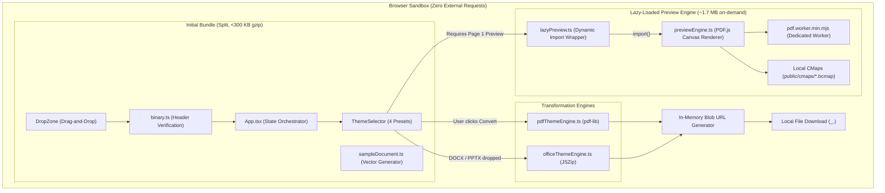
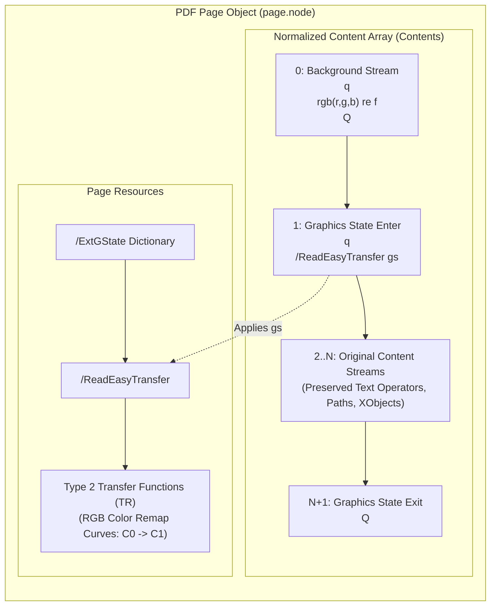
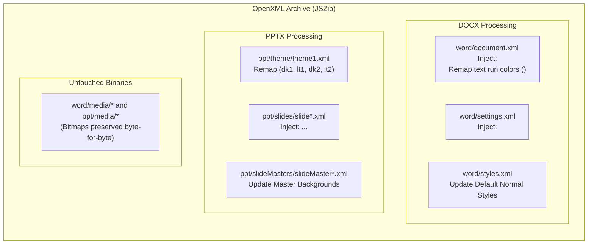

# ReadEasy

Client-side document restyler that transforms PDFs and Office documents into high-contrast dark and paper themes without rasterization. Vector paths and font glyphs remain scalable curves, text remains selectable/searchable, and processed file size increases by less than 4 KB.

Zero server infrastructure. Processing occurs entirely in-browser memory.

---

## Architecture Overview



---

## PDF Vector Transformation Pipeline

ReadEasy does not flatten pages to canvas bitmaps. It isolates the existing page streams and injects graphics state modifications directly into the PDF object tree:



### Stream Isolation Details
1. **`page.node.normalize()`**: Unifies single stream objects and arrays into a normalized `PDFArray`.
2. **Bounds Calculation**: Evaluates the bounding union of `MediaBox` and `CropBox` to prevent edge bleed across arbitrary PDF viewers.
3. **Background Injection**: A solid vector rectangle (`re f`) matching the target theme is prepended at index 0.
4. **Transfer State Enclosure**: A push operator (`q`) and `/ReadEasyTransfer gs` are injected at index 1, while a pop operator (`Q`) is appended at the end of the content stream array, preventing state leak.

---

## Office Document Architecture (DOCX & PPTX)

Office OpenXML files are ZIP archives containing XML definitions and binary media packages. ReadEasy restyles the styling nodes without altering the underlying document tree or embedded images.



---

## Theme Specifications

| Theme | UI Subtitle | Color Transfer Target | Background | Text Target |
|---|---|---|---|---|
| **Blackboard** | Dark Slate / Soft Chalk | Inverts white, floors darks | `#2B2B2B` | `#E5E5E5` |
| **Old Book** | Warm Cream / Sepia | Attenuates blue wavelengths | `#F4ECD8` | `#26221C` |
| **True Black** | OLED / High Contrast | Linear inversion ($1.0 \rightarrow 0.0$) | `#000000` | `#FFFFFF` |
| **Amber** | Retro Phosphor CRT | Amber phosphor curve | `#1A1A1A` | `#FFB000` |

---

## Technical Tradeoffs

| Factor | Canvas/Bitmap Rasterization | ReadEasy Vector Transformation |
|---|---|---|
| **Text Rendering** | Blurs and pixelates when zoomed | True mathematical Bézier curves at all scales |
| **File Size Delta** | $+10\text{ MB}$ to $+100\text{ MB}$ per document | $+500\text{ B}$ to $+3.5\text{ KB}$ total |
| **Text Selectability** | Lost (requires OCR to restore) | 100% native selection, copy, and Ctrl+F |
| **Processing Speed** | 1000–3000 ms per page | 5–15 ms per page |
| **Embedded Photos** | Unchanged | Luminance inverted in dark modes (Known vector limitation) |

> **Limitation Note**: Because full-page color transfer maps base luminance values, photographic images embedded in PDFs invert in dark modes. For DOCX/PPTX, embedded images reside in separate package parts (`media/*`) and remain completely untouched.

---

## Security & Self-Containment

- **No Remote Dependencies**: Character map files (`*.bcmap`) are bundled under `public/cmaps/`. No requests are made to third-party CDNs (such as jsDelivr or cdnjs).
- **Content Security Policy**: Enforced via `vercel.json` and `index.html`:
  ```
  default-src 'self'; script-src 'self' 'wasm-unsafe-eval'; style-src 'self' 'unsafe-inline'; img-src 'self' data: blob:; worker-src 'self' blob:; connect-src 'self' blob: data:; font-src 'self'; object-src 'none'; base-uri 'self'; form-action 'self';
  ```
- **Air-Gapped Processing**: All operations run inside Web Workers and main-thread JavaScript. No analytics, tracking pixels, or outbound telemetry.

---

## Repository Structure

```
├── public/
│   ├── cmaps/                     # 169 bundled offline character maps
│   └── favicon.svg                # Vector SVG icon
├── src/
│   ├── App.tsx                    # Main state machine
│   ├── index.css                  # Impeccable style tokens (monochrome)
│   ├── version.ts                 # Release version declaration
│   ├── components/
│   │   ├── Header.tsx             # Minimal brand header
│   │   ├── DropZone.tsx           # Drag-and-drop input & sample trigger
│   │   ├── ThemeSelector.tsx      # 4 theme configuration cards
│   │   ├── PreviewViewport.tsx    # Live Page 1 canvas preview & compare toggle
│   │   └── ActionBar.tsx          # Export trigger, progress, and file metadata
│   └── engine/
│       ├── binary.ts              # File header sanity checks & buffer cloning
│       ├── lazyPreview.ts         # Code-splitting dynamic import boundary
│       ├── previewEngine.ts       # PDF.js renderer with DPR retina scaling
│       ├── pdfThemeEngine.ts      # Vector PDF transform engine (pdf-lib)
│       ├── pdfThemeEngine.test.ts # Vitest regression suite for themes & ExtGState
│       ├── officeThemeEngine.ts   # JSZip XML engine for DOCX and PPTX
│       └── sampleDocument.ts      # Vector test document generator
├── vercel.json                    # Edge routing, headers, CSP, and caching
└── package.json                   # Dependencies and build scripts
```

---

## Development & Verification

```bash
# Install dependencies
npm install

# Run Vitest regression tests (validates all 4 themes & ExtGState /TR dictionaries)
npm run test

# Run development server
npm run dev

# Compile TypeScript and generate production bundle
npm run build

# Preview production build locally
npm run preview
```
